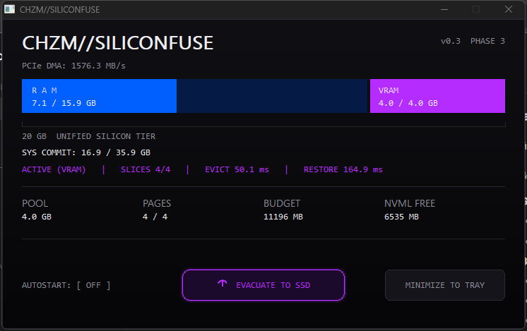

# CHZM SiliconFuse

**Heterogeneous Unified Memory Architecture for Windows 11**

Version 0.1 - Phase 0 (silicon cartography)
Owner: CHAZM / CHZMINFINITYCORE

---

## 1. What this is

SiliconFuse is an open architecture for presenting the physically distinct
memory of a Windows 11 workstation as a single, policy-managed address space:

- Tier 0 - system DRAM (DDR4), cache-coherent, lowest latency;
- Tier 1 - discrete GPU framebuffer (GDDR6) exposed to the CPU through the
  PCIe Resizable BAR aperture;
- Tier 2 - NVMe capacity used as an emergency spillover.

The project does **not** claim that 28 GB of identical DRAM exists. It
implements one physical address map, one allocation protocol and one residency
policy across three media with very different cost curves. The unified pool is
a software contract over real silicon, not a new memory device.

Phase 0 delivers the part that can be verified before any kernel code exists:
a read-only probe that measures what the platform actually exposes. The probe
in this repository (`CHZM_HardwareProbe.exe`) performs that measurement and
writes the result to `docs/HARDWARE_MAP.txt`.

---

## 2. Measured reference platform

Captured by `CHZM_HardwareProbe` v0.1 on 2026-11-05. Raw output:
[`docs/HARDWARE_MAP.txt`](docs/HARDWARE_MAP.txt).

| Component | Value |
|---|---|
| CPU | AMD Ryzen 7 5700X, 8C/16T |
| System RAM | 16384 MB DDR4-3800, 2 x 8 GB SK Hynix HMA81GU6DJR8N-XN |
| Usable RAM (OS) | 16293 MB |
| GPU | NVIDIA GeForce RTX 3060 12 GB, GA106, `VEN_10DE DEV_2504` |
| PCIe location | `09:00.0`, driver 32.0.16.1742 |
| Framebuffer | 12288 MB GDDR6 (registry `HardwareInformation.qwMemorySize`) |
| BAR0 | 16 MB at `0x00000000_F5000000` (registers) |
| BAR1 | **16384 MB at `0x00000078_00000000`** (prefetchable, large-memory descriptor) |
| Auxiliary BAR | 32 MB at `0x0000007C_00000000` |
| Unified target | 28672 MB (16384 MB + 12288 MB) |

Two findings from the measurement drive the rest of the architecture.

**Finding 1 - the ReBAR aperture is 16 GB, not 12 GB.**
A PCI BAR size must be a power of two. A 12 GB framebuffer therefore requires
a 16 GB aperture; the upper 4 GB of the window is address space without
backing and must never be touched. Any component that validates ReBAR by
comparing "aperture == 12288 MB" is wrong. Correct validation is
`aperture >= framebuffer` plus `aperture == next_power_of_two(framebuffer)`.

**Finding 2 - the aperture is already fully committed.**
While the probe was running, the WDDM stack reported 16355 MiB of the 16384 MiB
BAR1 aperture in use (`nvidia-smi -q`, BAR1 Memory Usage). The GPU is not an
idle resource waiting to be pooled; it is a live display adapter whose memory
manager has already claimed essentially the entire window. SiliconFuse
therefore cannot "add VRAM to RAM" by mapping BAR1 of another client. It must
negotiate.

**Finding 3 - direct CPU access to VRAM is measurable and asymmetric.**
`tools/ReBarBench` creates its own 64 MB D3D12 allocation with
`HEAP_TYPE_CUSTOM / CPU_PAGE_PROPERTY_WRITE_COMBINE / MEMORY_POOL_L1` and calls
`Map`. On this platform (WDDM 3.x, driver 32.0.16.1742) the runtime accepts the
combination and returns a CPU pointer into GDDR6. Measured:

| Metric | Result |
|---|---|
| Sequential write (AVX2 NT stores + sfence) | 10.2-10.9 GB/s |
| Sequential read (AVX2 uncached loads) | 35-37 MB/s |
| Sequential read (MOVNTDQA) | 250-252 MB/s |
| Access latency | 0.80-0.94 us per 64-bit read |
| Random 4K write | 2.0-2.8 M IOPS / 0.4-0.5 us |
| Random 4K read | 8.9-9.6 K IOPS / 105-113 us |
| Random 64K write | 159-174 K IOPS / 5.8-6.3 us |
| Random 64K read | 565-595 IOPS / 1.68-1.77 ms |
| GPU-verified integrity | PASS (copy engine readback of 64 MB) |

Writes are write-combined and bandwidth-bound; reads are uncached and each
access is a separate PCIe transaction. The same allocation read through the
copy engine reaches 12.5-12.6 GB/s. The correct Tier 1 policy is therefore:
**write through BAR1, read through DMA.** Full capture:
[`docs/REBAR_BENCHMARK.txt`](docs/REBAR_BENCHMARK.txt).

---

## 3. Tier hierarchy

| Tier | Medium | Capacity | Bandwidth (theoretical) | Access latency | Coherence |
|---|---|---|---|---|---|
| 0 | DDR4-3800, dual channel | 16 GB | 60.8 GB/s | 60-70 ns | CPU-coherent |
| 1 | GDDR6 over PCIe 3.0 x16 BAR1 | 12 GB | 15.75 GB/s | ~0.6-1.5 us | not coherent |
| 2 | NVMe SSD | policy-defined | ~3.5 GB/s | 50-100 us | block device |

Tier 1 numbers are the PCIe 3.0 x16 line rate (8 GT/s per lane, 128b/130b,
15.754 GB/s), before protocol overhead. Sustained host-to-device copies on
this class of platform typically land at 11-13 GB/s. The GPU's own GDDR6
bandwidth (360 GB/s on RTX 3060, 192-bit at 15 Gbps) is not available to the
CPU and is out of scope for Tier 1.

---

## 4. The WDDM problem

Windows Display Driver Model owns the display adapter. `nvlddmkm` and the
video memory manager (VidMm) allocate, evict and remap the framebuffer through
the GPU page tables. A second driver cannot simply claim BAR1:

- BAR1 is a CPU-visible window over the same GDDR6 that VidMm allocates;
  writing into pages owned by a live allocation corrupts the display stack;
- the aperture is a shared resource, not a partition - there is no hardware
  mechanism that assigns 4 GB to one client and 8 GB to another;
- WDDM has no public API that grants a third-party kernel driver framebuffer
  pages outside the normal allocation path.

SiliconFuse therefore defines **cooperative arbitration** instead of
replacement:

1. The pool driver never issues GPU commands and never touches the command
   processor.
2. It requests leases from a broker that is aware of VidMm budget pressure.
3. A lease is revocable. When WDDM needs the pages back, the lease enters
   `EVICTING`, data is flushed to Tier 0 or Tier 2, and the range is returned.
4. Without a vendor-side contract (or exclusive compute mode), the only safe
   behaviour is to refuse the lease.

Details, state machine and failure handling: [`docs/ARCH_SPEC.md`](docs/ARCH_SPEC.md).

### 4.1 Measured arbitration (Phase 2.1, chunked pool)

`tools/LeaseBroker` now holds 4 GB as four independent 1 GB slices. The single
4 GB allocation is refused by WDDM; four slices are granted. The pool is
evicted only by the measured deficit, so a 6 GB load keeps half the pool
resident while an 8 GB load takes all of it.

Partial-yield capture: [`docs/WDDM_LEASE_PARTIAL.txt`](docs/WDDM_LEASE_PARTIAL.txt).
Full-yield capture: [`docs/WDDM_LEASE_REPORT.txt`](docs/WDDM_LEASE_REPORT.txt).

| Case | 6 GB load (partial) | 8 GB load (full) |
|---|---|---|
| Pool | 4096 MB in 4 x 1024 MB | 4096 MB in 4 x 1024 MB |
| CPU fill, AVX2, 2048 MB dirty | 5.26 GB/s | 5.09 GB/s |
| Deficit seen | 1039 MB | 2053 MB, then 1012 MB |
| Slices released | 2 (2 GB) | 3, then 1 (4 GB) |
| Resident after yield | 2048 MB | 0 MB |
| Eviction time | 353 ms (copy 231 ms) | 1056 ms total (first release 372 ms) |
| Restore | 224 ms (2 slices) | 472 ms (4 slices) |
| Pressure commit | 6144 MB in 0.3 s | 8192 MB in 0.77 s |
| Result | no TDR, final ACTIVE | no TDR, final ACTIVE |

Three conclusions that matter for the design:

1. **Chunking solves the 4 GB allocation.** WDDM refused one 4 GB WC L1
   resource but granted four 1 GB resources on the same machine. The ceiling is
   fragmentation and per-resource constraints, not framebuffer size.
2. **Budget notifications alone are not a reliable trigger.** In several runs
   the broker's per-process budget shrank and in others it stayed at 11 GB
   while WDDM paged silently. Global free VRAM (`nvml.dll`, loaded dynamically)
   is used as a second signal with a 1 GB tolerance. Without it, arbitration
   was not deterministic.
3. **Deficit must be bounded by a tolerance, not by the baseline.** Chasing the
   exact pre-load free-VRAM baseline always drains the whole pool. Releasing
   down to `baseline - 1 slice` yields 2 of 4 slices under a 6 GB load and all
   4 under 8 GB, which is the intended behaviour.

Safety note: an earlier run was started while a Cyberpunk 2077 session was
active. The 8 GB allocation plus 4 GB pool exhausted system resources and the
game crashed with `ERROR_NO_SYSTEM_RESOURCES`. Both tools now abort when NVML
GPU utilization exceeds 40 percent (median of five samples) unless
`--allow-busy` is passed, and the runner cancels if the broker exits at start.

### 4.2 User-mode engine (Phase 3)

`CHZM_SiliconFuse.exe` is the master binary: the same pool and arbitration
engine, a storage bridge, and the `CHZM//INFINITYCORE` window.



Measured on the reference machine (log in
`%LOCALAPPDATA%\CHZM-SiliconFuse\engine.log`):

| Item | Result |
|---|---|
| Pool | 4096 MB in 4 x 1024 MB slices |
| Dirty window | 64 MB per slice |
| Manual eviction (4 slices) | 89.97 ms |
| Manual restore (4 slices) | 158.91 ms |
| Window | 920x540, dark DWM title, live RAM/VRAM/commit |
| Autostart | HKCU Run key, toggle in the UI |
| Close button | hides to tray; double-click restores |

The window is a real control surface, not a mock: the power button evicts or
restores the pool and the numbers come from the engine. `docs/ui.png` is a
capture of the running binary.

**Pagefile attachment is not implemented.** There is no block-device driver,
so there is no volume to format; formatting a real volume would be
destructive; and `NtCreatePagingFile` has the signature
`(UNICODE_STRING*, LARGE_INTEGER*, LARGE_INTEGER*, ULONG Priority)` - no
`flags` argument and no `HybridPriority=7`. The engine logs
`paging: not attempted` with the reason and leaves the C: pagefile untouched.
A pagefile on a VRAM pool that evicts by design is also a direct path to
bugcheck 0x1A/0xC2, which is exactly the failure the project must avoid.

---

## 5. Repository layout

```text
CHZM-SiliconFuse/
├── docs/
│   ├── ARCH_SPEC.md          Architecture specification (tiers, WDDM, ReBAR)
│   ├── WHITEPAPER.md         Position paper for review and publication
│   ├── HARDWARE_MAP.txt      Raw output of the topology probe
│   ├── REBAR_BENCHMARK.txt   Raw output of the direct-access benchmark
│   └── WDDM_LEASE_REPORT.txt Raw output of the arbitration test
│   └── WDDM_LEASE_PARTIAL.txt Partial-yield case (6 GB load)
├── src/
│   ├── engine/               VramPool, StorageBridge, PagingManager
│   ├── gui/                  MainWindow (CHZM//INFINITYCORE)
│   ├── kernel/               Planned WDF companion driver (Ring 0)
│   └── common/               chzm_pool_protocol.h - shared user/kernel ABI
├── tools/
│   ├── HardwareProbe/        main.cpp - PCIe BAR / memory topology probe
│   ├── ReBarBench/           main.cpp - direct MMIO vs copy-engine benchmark
│   └── LeaseBroker/          main.cpp (broker) + gpu_pressure.cpp (load)
├── build_probe.bat           MinGW-w64 build (and optional run) script
├── build_bench.bat           MinGW-w64 build (AVX2, D3D12/DXGI)
├── build_broker.bat          MinGW-w64 build (broker + pressure)
├── build_final.bat           Master binary (engine + GUI)
├── run_lease_test.bat        Automated arbitration test
└── README.md
```

`src/kernel/` is intentionally empty of code. A driver that maps framebuffer
physical pages is a security boundary and will not be published until the
arbitration contract in `ARCH_SPEC.md` is validated.

---

## 6. Build and run

Requirements: Windows 10/11 x64, MinGW-w64 g++ 13 or newer.

```bat
build_probe.bat              :: build, run, write docs\HARDWARE_MAP.txt
build_probe.bat --build-only :: build only

build_bench.bat              :: build, run, write docs\REBAR_BENCHMARK.txt
build_bench.bat --size 2048  :: single 2048 MB suite

build_broker.bat             :: build broker + pressure emulator
run_lease_test.bat           :: automated arbitration test, writes the report
build_final.bat              :: master binary build\CHZM_SiliconFuse.exe
```

Output binaries: `build\CHZM_HardwareProbe.exe`,
`build\CHZM_ReBarBench.exe` (AVX2, links `-ld3d12 -ldxgi`).

The probe uses SetupAPI and the Configuration Manager only; it has no external
dependencies and performs no writes. For display adapters,
`CM_Get_Alloc_Log_Conf` can return `CR_FAILURE` because the graphics driver
owns the live configuration rather than the PnP allocator. When that query
does not yield windows, the probe falls back to the firmware-persisted
`Enum\<instance>\LogConf\BootConfig` resource list, which contains the same BAR
programming, and states the source explicitly in the report.

Exit code 0 means an NVIDIA adapter and a non-zero memory aperture were found;
1 means the topology could not be resolved.

The benchmark allocates its own D3D12 buffers, never touches another client's
memory, and verifies every path with bit-exact comparison. It writes no
hardware state beyond its own resources.

---

## 7. Roadmap

| Phase | Scope | Gate |
|---|---|---|
| 0 | Silicon cartography (this release) | Probe reproduces the map on two platforms |
| 1 | Host-side pool broker, user mode | Lease protocol exercised against a reserved aperture |
| 2 | Budget-aware eviction (this release) | Broker yields on pressure, restores, no TDR |
| 2.1 | Chunked 4 GB pool, granular eviction (this release) | 4 x 1 GB slices, partial yield under 6 GB load |
| 3 | User-mode engine + control UI (this release) | 4 GB pool, manual/auto eviction, live UI |
| 4 | WDF companion driver, block device, pagefile | Signed driver, IOMMU, no bugcheck in soak |
| 5 | CryoSwap: DDR4 offload of background processes (this release) | Quota + EmptyWorkingSet, audio and foreground victims untouched |
| 6 | CommitGuard, StandbyPurge, BAR1 telemetry (this release) | Pool never eats the WDDM commit reserve |
| 7 | Honest GDDR6 hibernation: MEM_RESET -> DMA -> WriteProcessMemory (this release) | 512 MB returns 100% bit-for-bit after the RAM copy is wiped |
| 8 | AVX2 checksum, sub-timers, 64/128/256/512 MB matrix (this release) | 512 MB hash < 15 ms, full restore < 350 ms |
| 9 | Fail-safe mirror, eviction survival, exit auto-restore (this release) | 100% recovery after full VRAM eviction and a wiped RAM copy |

Phase 1 and later require either an NVIDIA cooperation agreement or an
exclusive-compute configuration in which the display driver is not bound to
the adapter. The project will publish negative results rather than ship an
unsafe mapping path.

---

## 8. Design constraints

- No user-mode proxy (ImDisk, CUDA, DirectStorage shims) in the data path.
- No undocumented GPU commands, no firmware modification, no PCI config writes.
- Every kernel mapping must be demand-lease based and revocable.
- The pool driver must survive adapter reset, driver update and hot-plug.
- All diagnostics are read-only unless the operator explicitly opts in.

---

## 9. Status and limitations

- Probe status: working on the reference machine; validated against
  `nvidia-smi` (BAR1 16384 MiB) and SMBIOS (DDR4-3800, 2 modules).
- Benchmark status: working; direct MMIO path accepted by the runtime,
  GPU-verified by copy-engine readback. Results in `docs/REBAR_BENCHMARK.txt`.
- Kernel status: design only.
- The 28 GB figure is a target envelope. Real usable capacity is always lower
  than 28672 MB because the OS reserves RAM, VidMm owns most of the aperture,
  and Tier 1 pages require an explicit lease.
- PCIe link width and generation are not read by the probe. Win32 exposes no
  supported API for the negotiated link state; the 3.0 x16 figure in this
  document is the platform assumption, not a measurement.
- Accepting `CUSTOM + WRITE_COMBINE + L1` is driver and WDDM-version specific.
  The benchmark must probe it at run time; there is no API contract that
  guarantees it across vendors.
- A single 4 GB WC L1 allocation is refused by the driver on the reference
  machine; four 1 GB slices are granted. The ceiling is fragmentation and
  per-resource constraints, not the 12 GB framebuffer size.
- Global free-VRAM telemetry comes from `nvml.dll`, loaded dynamically. It is
  a driver component, not a D3D12 contract, and is used only because
  per-process WDDM budgets proved unreliable as a pressure signal.
- A heavy test must not run while a game is active. The tools now refuse to
  start above 40 percent median GPU utilization; this guard was added after a
  Cyberpunk 2077 session crashed during a background run.
- The user-mode engine cannot create a block device, format a volume or attach
  a pagefile. Those steps require a signed kernel driver and are not faked.
  `NtCreatePagingFile` has no flags argument; the C: pagefile is untouched.

See the risk section of `docs/ARCH_SPEC.md` before quoting any number from
this repository.

---

## 10. Stage 7-8: CryoSwap measured on the reference platform

`CryoSwap` moves private pages of background processes into the GDDR6 pool,
tells the kernel to drop them (`MEM_RESET`, so nothing is written to
`pagefile.sys`), clamps the working set and suspends the process. Focus restores
it: `MEM_RESET_UNDO` when the pages survived, otherwise a copy-engine DMA out of
VRAM followed by `WriteProcessMemory`.

### 10.1 Honest end-to-end matrix (2026-11-05, RTX 3060 12 GB, 32 GB DDR4)

| Size | WS before | WS after | Avail RAM delta | DMA ms | Hash ms | WPM ms | Restore ms | Bit match |
|---|---|---|---|---|---|---|---|---|
| 64 MB | 72.7 | 24.0 | +34 MB | 8.9 | 1.71 | 18.9 | 39.22 | 100% |
| 128 MB | 136.7 | 24.0 | +103 MB | 16.7 | 3.58 | 48.7 | 78.00 | 100% |
| 256 MB | 264.7 | 24.0 | +220 MB | 33.1 | 7.28 | 127.3 | 176.75 | 100% |
| 512 MB | 520.7 | 23.9 | +489 MB | 64.6 | 14.86 | 302.4 | 391.07 | 100% |

Single run; `WriteProcessMemory` varies by roughly 20 percent between runs
(249-302 ms at 512 MB), everything else stays within 2 percent.

### 10.2 Sub-timers, 512 MB

| Phase | Stage | ms |
|---|---|---|
| Freeze | suspend + thread snapshot | 20.93 |
| Freeze | `ReadProcessMemory` | 41.92 |
| Freeze | AVX2 write into BAR1 | 47.21 |
| Freeze | checksum | 14.64 |
| Freeze | `MEM_RESET` + quota + `EmptyWorkingSet` | 47.07 |
| Restore | GPU DMA (copy engine + fence) | 64.64 |
| Restore | checksum | 14.86 |
| Restore | `WriteProcessMemory` | 302.44 |
| Restore | quota release + `NtResumeProcess` | 2.51 |

### 10.3 Integrity proof

For every size the test forces the "data is gone" condition before restoring:

- the victim's pages are overwritten with zeros through `WriteProcessMemory`;
- `MEM_RESET` + `HARDWS_MAX` + `EmptyWorkingSet` + standby purge discard them;
- `MEM_RESET_UNDO` returns `NULL`, so no recovery from RAM or pagefile is possible;
- the 512 MB restore is fed only by the copy engine from the four 1 GB slices.

Three hashes are recorded per size: `orig_hash`, `zeroed_hash` (differs, as it
must) and `restored_hash` (equal to `orig_hash`), and the victim re-reads its own
buffer after resume: **100.0000% bit-for-bit**.

### 10.4 What the numbers actually mean

- The AVX2 checksum runs at 34.8 GB/s (1.80 ms / 64 MB); the sequential FNV-1a
  it replaced needed ~350 ms for 512 MB.
- Restore is no longer DMA bound. At 512 MB the copy engine needs 64.6 ms
  (8.1 GB/s), the checksum 14.9 ms, and `WriteProcessMemory` 302 ms (~1.7 GB/s,
  the kernel copy is the bottleneck).
- Freeze is bound by `ReadProcessMemory` (42 ms) and the AVX2 store into BAR1
  (47 ms) at 512 MB; both scale linearly.
- Mode B (`EmptyWorkingSet` alone) drops the working set to 0 MB but pays one
  page fault per 4 KB on the next touch: 131 072 faults for 512 MB. CryoSwap
  pays 249 ms of write-back instead and keeps the bytes in VRAM.
- `StandbyPurge` needs `SE_PROF_SINGLE_PROCESS`; without an elevated token the
  call is a logged no-op.

---

## 11. Stage 9: fail-safe recovery

Frozen pages are never stored in one place only. Every chunk written into a
GDDR6 slice is also written, synchronously, into a disk-backed mirror owned by
`StorageBridge` (`cryo_mirror.bin`, 4 GB sparse). The mirror costs throughput at
freeze time but it is the only thing that survives a TDR, a driver reset or a
game taking the VRAM back.

Restore is a two-source state machine:

1. try the copy engine from VRAM;
2. verify the AVX2 checksum of the region;
3. on any failure (slice evicted, DMA refused, checksum mismatch) rebuild that
   region from the mirror and verify again;
4. only a region proven byte-for-byte is written back with
   `WriteProcessMemory`;
5. `NtResumeProcess` is **never** issued for a process whose data could not be
   proven — the process stays suspended and the event is logged as CRITICAL.

### 11.1 Measured validation (`--torture-test`, 2026-11-05)

| Test | Result |
|---|---|
| Exact timer accounting 512 MB | sum(phases) + overhead = 492.03 ms, delta 0.00 |
| Exact timer accounting 1024 MB | sum(phases) + overhead = 930.68 ms, delta 0.00 |
| Three victims (64/128/256 MB) frozen at once | 3/3, +307 MB available RAM, all 100.0000% after shuffled restore |
| VRAM fully evicted while frozen | 13/13 regions recovered from the mirror, checksum MATCH, 100.0000%, 182.61 ms |
| Exit path (`RestoreAllFrozen`) | 1/1 resumed, 0 left frozen, 100.0000% |

Sub-timers for 512 MB freeze: suspend 20.46, region scan 2.05,
`ReadProcessMemory` 45.77, AVX2 into BAR1 47.17, **mirror write 292.98**,
checksum 15.37, `MEM_RESET`+trim 48.46, overhead 19.77.

The mirror is the new freeze bottleneck (1.8 GB/s of synchronous disk I/O). It
is written with `WriteFile` into the OS cache, so a process crash still leaves a
consistent file; an asynchronous variant is the obvious next optimisation.
